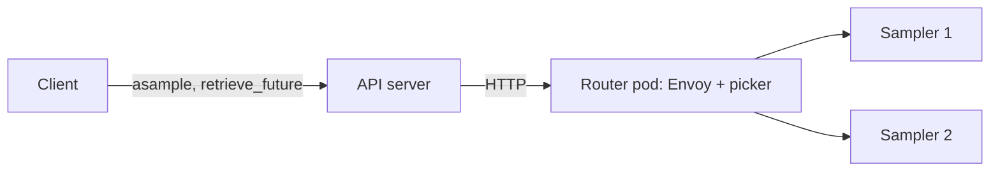
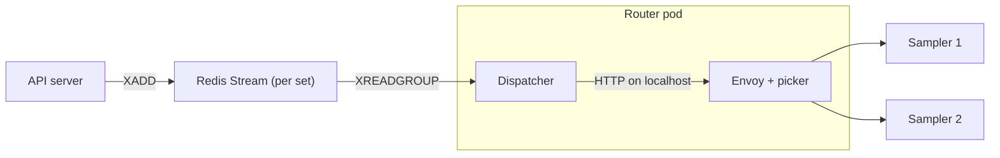

# Routed sampling through llm-d

OpenRL can send a LoRA job's samples through an llm-d router, which picks the
sampler replica by queue depth, KV cache use and cached prefix. Each sampler set
gets one CPU pod with Envoy and the endpoint picker. The set's samplers are stock
`vllm serve` from vLLM's published image, labelled `openrl.io/sampler-set` for the
picker to select by.

## Samplers are stock vLLM

A routed request is an ordinary OpenAI completion: token IDs as the prompt,
`return_token_ids`, `logprobs=0` and, when asked, `prompt_logprobs=0`.
`sampler_routing.sample` turns the answer into the sample the queue's samplers
return, verified against a live vLLM 0.30 (`LiveVllmTest`).

**Weights are named, never loaded by hand.** `save_weights_for_sampler` freezes
each adapter into `$OPEN_RL_TMP_DIR/sampler_lora/<sha256(ref)>`, and the samplers
run vLLM's filesystem LoRA resolver over that directory. A request names the
snapshot directory as its `model`, and vLLM loads it on first use. A job that has
not saved yet samples its base model. A training job's live adapter has no fixed
name and is refused, so a retry can never pick up newer weights.

The samplers start with `--generation-config=vllm`, and `route` sends the queue
samplers' defaults (`temperature=1`, `top_p=1`, `top_k=-1`) for missing fields,
so the model's own generation defaults never change what is sampled.

The setting `openrl.sampler_router` picks who sends the requests:

| Mode | Sender | A request survives |
| - | - | - |
| `llmd` | The API server, from memory | Sampler and router restarts. An API restart loses it, and the client sends it again. |
| `llmd-stream` | The set's dispatcher, from a Redis Stream | Sampler, router, dispatcher and API restarts. |

Both use the same retry loop (`sampler_routing.route`): each attempt is one HTTP
call, retried with capped, jittered backoff until it succeeds, fails for good, or
reaches its deadline. vLLM aborts the generation when a call is dropped.

| Sampler answer | Action |
| - | - |
| 200 | Saved |
| 400 (the request can never succeed), 404 (no such adapter) | Saved as a failure |
| 503, 500, 504, a timeout, or a dropped connection | Retried |
| No sampler ready (the router answers 503) | Retried |
| Deadline reached | Saved as a failure |

A lost response can mean generation finished but the result never arrived, so a
request may be generated twice. Only one result is ever saved.

## Why route at all

The queue lets the first free sampler claim a request, whether or not it holds
the prompt in cache. Agent rollouts resend a long, growing prefix every turn, so
cache placement decides step time. On the Harvey recipe (Qwen3.5 9B, 4 samplers),
one comparison at the same work spent 19 minutes sampling per step against the
queue's 32.

## `llmd`: the API server sends

1. `asample` starts a task in the API process and returns the request ID at
   once. The ID starts with `routed-`.
2. The task sends the request through the set's router Service and saves the
   result as an ordinary future. The request leaves the in-memory map only after
   its result is saved.
3. `retrieve_future` for a `routed-` ID that is not in the map reads the saved
   result. If there is none, the process restarted before the sample finished,
   and it answers **410**.
4. The tinker client treats 410 as a lost promise and sends the sample again
   (`RetryableException`, retried by `SamplingClient`'s retry handler). Training
   requests are never resent this way; only sampling retries the whole call.

On a planned stop the API server lets its running samples finish for
`OPEN_RL_SAMPLE_DRAIN_SECONDS` before exiting. Only a crash, or a sample longer
than the drain, makes the client resend.

This assumes one API server per Redis: a second replica would answer 410 for the
first one's requests.

## `llmd-stream`: the dispatcher sends from a stream

Each set has two kinds of key, under the hash tag `{set}`:

| Key | Holds |
| - | - |
| `openrl:{set}:stream` | One entry per unfinished request. The entry ID is the request ID. |
| `openrl:{set}:result:<entry>` | The saved result, for `OPEN_RL_SAMPLE_RESULT_TTL`. |

- **Accept**: `XADD … NOMKSTREAM`. The worker manager creates the stream with
  the set and deletes it with the set, so a removed set refuses new work.
- **Dispatch**: one dispatcher per set, always under the consumer name
  `dispatcher`, reads only as many new entries as it has free slots. The
  Deployment's Recreate strategy keeps it the only one.
- **Finish**: one `MULTI`: `SET NX` the result, `XACK`, `XDEL`. The first result
  wins and the stream holds only unfinished requests.
- **Restart**: a new dispatcher first reads its own pending entries (`XREADGROUP
  … 0`), which are exactly those the last one took and never finished.
- **Retrieve**: the saved result; pending while the entry is in the stream; a
  failure otherwise.

The stored input never changes, and it names its snapshot, so a retry hours
later samples the same weights.

Redis holds the only copy of accepted work: run it with persistence and keep its
eviction policy from removing these keys.

## Not in this version

- Fairness between tenants.
- Full fine-tuning, whose weights change in place under one name.
- With `llmd-stream`: fencing between two dispatchers (Recreate prevents
  overlap; if two ever run, both may execute a request, and one result is kept).
  Removing a set drops its unfinished requests, which then read as not found.
- With `llmd`: more than one API server per Redis. A removed set's in-flight
  samples keep retrying until their deadline.
