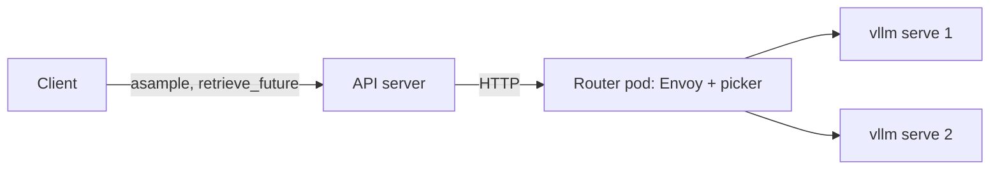

# Routed sampling through llm-d

With `openrl.sampler_router=llmd`, a LoRA job's samples skip the sampler queue.
The API server sends each one over HTTP to its sampler set's llm-d router, which
picks the replica by queue depth, KV cache use and cached prefix.

## Why

The queue gives a request to the first free sampler, whether or not it holds the
prompt in cache. Agent rollouts resend a long, growing prefix every turn, so cache
placement decides step time. On the Harvey recipe (Qwen3.5 9B, 4 samplers) the
same work spent 19 minutes sampling per step routed, against 32 on the queue.

## Shape

- **Samplers are stock `vllm serve`** from vLLM's published image, labelled
  `openrl.io/sampler-set` for the picker to select. They start with
  `--generation-config=vllm`, so the model's own generation defaults never change
  what is sampled.
- **Weights are named, never loaded by hand.** `save_weights_for_sampler` freezes
  each adapter into `$OPEN_RL_TMP_DIR/sampler_lora/<sha256(ref)>`, and the samplers
  run vLLM's filesystem LoRA resolver over that directory. A request names the
  snapshot as its `model`, and vLLM loads it on first use. A training job's live
  adapter has no fixed name and is refused.
- **Each set has one router pod and a Service** (`src/server/llmd_router.yaml`),
  created with the set's samplers and deleted with them.
- **`sampler_routing.route`** turns the sampling request into an OpenAI completion
  (token IDs, `return_token_ids`, `logprobs=0`, `prompt_logprobs=0` when asked) and
  the answer back into the sample the queue's samplers return. `LiveVllmTest`
  checks it against a real vLLM.

## Failures

| Event | What happens |
| - | - |
| Sampler answers 400 or 404 (no such adapter) | Saved as a failure |
| 5xx, timeout, dropped connection, no sampler ready | Retried with capped backoff until the deadline |
| A sampler or the router restarts | Retried; the client does not notice |
| The API server restarts | Running samples are lost. `retrieve_future` answers 410 for them, and the tinker client sends each again. |

Samples are safe to redo: the weights are fixed and RL does not need the same
tokens. A lost response can mean a sample was generated twice; one result is kept.

## Limits

- One API server per Redis: another replica would answer 410 for the first one's
  samples.
- No fairness between tenants beyond what vLLM and the picker give. llm-d's Flow
  Control is where that would go.
- Full fine-tuning is not routed: its weights change in place under one name.
