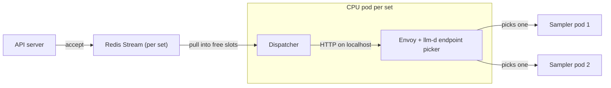

# Durable routed sampling: one Redis Stream and one dispatcher per sampler set

OpenRL keeps every accepted sampling request until a result is saved, across
restarts of the API server, the dispatcher, the router and the samplers. Each
sampler set has one Redis Stream and one CPU pod. The pod's dispatcher pulls
stored work and sends it over HTTP through the llm-d router, which picks the GPU
sampler.

This covers LoRA sampling with fixed weights, behind `openrl.sampler_router=llmd`.
Tenant fairness and full fine-tuning are not in this version.

## Why

**The queue loses a request when its sampler dies.** A sampler takes a request off
a Redis list with `BLPOP`/`LPOP` before it generates, and saves the result as a
separate step. If the sampler stops in between, the request is gone and the client
polls forever.

**Pushing from the API server through a router loses the same request.** The router
can pick the replica that caches the prompt, but a task in the API process does not
survive an API restart.

**So the dispatcher pulls stored work and pushes it through the router.**

| Option | Gains | Loses |
| - | - | - |
| Samplers pull from a shared queue | Each sampler takes work when it has room | The first sampler to claim a request may not hold its prompt in cache; a claimed request dies with the sampler |
| The API pushes through llm-d | The router picks the replica by cache and load | Unfinished work does not survive an API restart |
| A dispatcher pulls stored work, then pushes through llm-d | Accepted work is recoverable, and the router picks the replica | OpenRL runs the dispatcher and owns retries |

## Request flow

1. The API validates the request, fixes its weights and appends it to the set's
   stream. The stream entry's ID is the request ID, returned once the write succeeds.
2. The dispatcher reads only as many entries as it has free slots. Redis keeps each
   one pending until it is acknowledged.
3. The dispatcher sends the request through Envoy on localhost. The picker chooses a
   ready sampler by queue depth, KV cache use and cached prefix.
4. The sampler returns the full result on the same HTTP call. The dispatcher saves
   it, acknowledges the entry and deletes it, in one transaction.
5. The client polls `retrieve_future` as before, and gets the saved result.

## What Redis holds

Each set has three kinds of key, all under the hash tag `{set}` so each transaction
stays on one node of a sharded Redis:

| Key | Holds |
| - | - |
| `openrl:{set}:stream` | One entry per unfinished request: its input. Finished entries are deleted, so the stream's length is the set's unfinished count. |
| `openrl:{set}:admission` | `open` or `closed`. |
| `openrl:{set}:result:<entry>` | The saved result, kept for `OPEN_RL_SAMPLE_RESULT_TTL`. A request is finished when this key exists. |

Only plain Redis commands are used:

- **Accept** is a transaction that watches the admission flag, checks it is open and
  the stream is under the set's limit, and appends the entry. Closing the set
  changes the watched flag, so an accept racing a close retries and is refused. The
  limit is approximate: a few concurrent accepts can pass it together.
- **Finish** is one `MULTI`/`EXEC`: save the result with `SET NX`, `XACK`, `XDEL`.
  The first result wins; a late or repeated attempt, or a result after a
  cancellation, changes nothing.
- **Recovery** is `XAUTOCLAIM`: entries no consumer has touched for
  `OPEN_RL_DISPATCH_RECLAIM_IDLE` seconds go to the dispatcher that asks. A running
  dispatcher touches its own entries with `XCLAIM … JUSTID` so they never look idle.

## Request contract

The stored input holds the prompt tokens, sampling parameters, fixed weights,
acceptance time and deadline. It never changes.

**Weights are fixed at acceptance.** A `sampler_weights` reference names a frozen
snapshot (`save_weights_for_sampler` copies the adapter before it returns), and the
stored input carries that snapshot's path. A training job's live adapter is refused:
a retry must never pick up newer weights. A job that has not trained yet samples its
base model.

The client sees pending work or one saved outcome: success, failure, cancellation or
deadline expiry. Reading a result does not consume it. An unknown or expired ID
reads as a failure, never as pending.

Recovery applies to an accepted ID. If the acceptance reply is lost, submitting again
creates a second request; deduplicating submissions is not in this version.

## Retries and failures

A request is retried until it succeeds, fails for good, or reaches its deadline
(`OPEN_RL_SAMPLE_DEADLINE_SECONDS`, counting queueing and every attempt).

| Event | Action |
| - | - |
| Invalid input at submission | Refused before acceptance |
| Sampler answers 200 with a sample | Saved |
| Sampler answers 400 (the request can never succeed) | Saved as a failure |
| Sampler's response breaks the contract | Saved as a failure |
| 503, 500, 504, a timeout, or a dropped connection | Retried with capped, jittered backoff; a bounded `Retry-After` on 429/503 is honoured |
| No sampler ready (the router answers 503) | Retried the same way |
| Deadline reached | Saved as a failure |
| Set removed | Every unfinished request saved as cancelled |
| A Redis error | The dispatcher waits and checks whether the request is already finished before trying again |

A lost HTTP response can mean generation finished but the result never arrived, so
recovery may generate again. Only one result is ever saved. Each attempt gets its own
engine request ID, and the sampler cancels generation when the call is dropped or the
attempt's deadline passes.

## Capacity

The API refuses, before acceptance, requests outside the limits: sample count,
prompt plus output beyond the model's window, payload size, and the set's
unfinished limit (`OPEN_RL_SAMPLE_UNFINISHED_LIMIT`). The dispatcher works on at most
`OPEN_RL_DISPATCH_ACTIVE` requests at once, counting those waiting to retry, and
reads only enough entries to fill free slots.

## Deployment

Each set gets one Deployment, `openrl-dispatch-<set>`, with the dispatcher, Envoy and
the endpoint picker in one pod, replaced with the `Recreate` strategy so the old
dispatcher has stopped before a new one starts. No sampler replica has a special
role. The pod needs no GPU and may run on a GPU node's spare CPU. The picker selects
the set's samplers by label; the dispatcher pod carries a different label, so it is
never mistaken for one.

A pod restart pauses dispatch; it does not touch the stream or accepted work. On a
planned stop the dispatcher stops reading, lets active calls finish within its grace
period and leaves the rest pending. A dispatcher that dies leaves its entries to be
reclaimed by the next one.

Removing a set closes it to new requests and saves its unfinished requests as
cancelled before the dispatcher is deleted.

**Redis holds the only copy of accepted work.** Run it with persistence (an
append-only file on a persistent disk) and keep its eviction policy from removing
these keys. An append-only file flushed every second can lose the last second of
accepted requests in a crash.

## Not in this version

- Fencing between two dispatchers. If two ever run at once, both may execute a
  request; only one result is saved.
- A per-request attempt limit. The deadline bounds retries.
- Stopping an attempt already running when its set is removed. The request is saved
  as cancelled at once, and the attempt's result is discarded.
- Fairness between tenants. New work is read in stream order.
- Full fine-tuning, whose weights change in place under one name.
- Deduplicating repeated submissions.

## Validation

Unit tests run against a real Redis and the real sampler HTTP app; only vLLM's
generate is replaced. They cover acceptance limits, one saved result per request,
recovery of untouched entries, deadlines, waiting for a ready sampler, set removal,
and a request accepted by one API process and finished after another starts.
