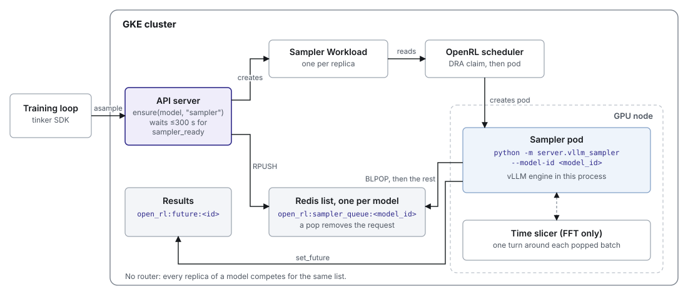
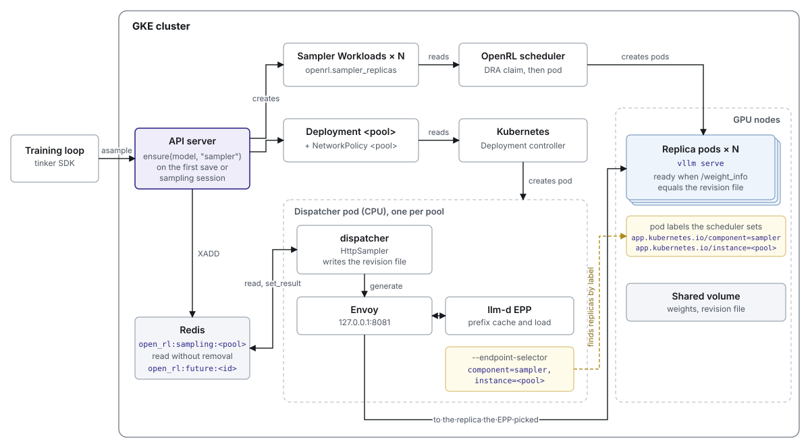

# 017: Sampling pools

**Status:** Implemented on the `pools/*` branch stack in ShubyM/open-rl (#32 to #36). Not merged.
**Date:** 2026-10-20.

This document describes how sampling worked before pools, how it works now, and
which component starts which other component. It covers cluster mode
(`OPEN_RL_WORKER_MANAGER=scheduler`) and notes where local mode differs.

## 1. Summary

Before pools, each model had one Redis list of sampling requests. A sampler
worker with vLLM in its own process removed requests from the list and answered
them.

Now, each model has a *sampling pool*. Each pool keeps its pending requests in a
Redis stream of its own. A *dispatcher* reads the pool's stream, gives each
request to a *sampler*, and saves the first result. There are two kinds of
sampler:

| Sampler | Used when | What runs |
| --- | --- | --- |
| `HttpSampler` | The pool has two or more replicas. | A dispatcher pod (dispatcher, Envoy, llm-d EPP) sends through the router to N `vllm serve` replica pods. |
| `vllm_sampler.Sampler` | The pool has one replica. | One replica pod with vLLM inside its process. It runs the dispatcher loop itself. When it shares its GPU with its trainer, it takes a time-slicer turn around each batch. |

Both kinds use the same dispatcher loop, the same kind of stream, and the same
rules for results.

### Words used in this document

- **Replica.** A pod that runs vLLM.
- **Sampler.** The object the dispatcher gives requests to: `HttpSampler`,
  which reaches replicas over HTTP, or `vllm_sampler.Sampler`, which owns an
  engine in its own process.
- **Exclusive.** A job whose metadata asks for GPUs of its own
  (`exclusive: true`). Its workers never share a GPU.
- **Revision.** One immutable set of FFT weights, a directory on the shared
  volume. LoRA requests have no revision; they name their adapter instead.
- **Parking.** The node's time slicer moves a process's GPU memory to host
  memory, with the llm-d snapshot agent and cuda-checkpoint, so another
  process can use the GPU.

## 2. Before: one queue per model

### What launched what

1. `create_sampling_session` or `save_weights_for_sampler` called
   `ensure(model, "sampler")`. In cluster mode the API server created a sampler
   Workload, and the scheduler created its pod.
2. The pod ran `python -m server.vllm_sampler --model-id <runtime>`. It built
   vLLM in its process, then wrote `open_rl:sampler_ready:<runtime>`.
3. The API server waited for that key, for up to 300 seconds, before it
   returned the sampling session.

### One request

1. `asample` pushed a request onto the model's list,
   `open_rl:sampler_queue:<model_id>`. An FFT request named the
   weights path. A LoRA request named the adapter's working directory,
   `<tmp>/peft/<id>/<id>`.
2. The sampler waited for one request with `BLPOP`, then removed the rest of
   the list. It grouped the requests by weights path and loaded new weights
   between groups.
3. The sampler wrote each result to `open_rl:future:<request_id>`.

### Time slicing

An FFT sampler on its trainer's GPU registered with the node's time slicer. It
held one turn around each batch it removed from the list: acquire, wake vLLM,
answer, sleep vLLM, release, and the slicer parked it.

### Problems

- **Lost requests.** A request left Redis when the worker read it. A worker
  that stopped mid-batch lost the batch, and the client waited until its own
  timeout.
- **No routing.** Replicas competed for one list. No replica was chosen by its
  prefix cache or its load.
- **A blocking session.** `create_sampling_session` waited for the sampler to
  start, for up to 300 seconds.
- **Mutable adapters.** A LoRA request read the adapter's working directory,
  which the next save overwrote.

## 3. Now: what launches what

The diagram shows a routed pool. The scheduler labels each replica pod with
`app.kubernetes.io/component=sampler` and `app.kubernetes.io/instance=<pool>`.
The EPP runs with `--endpoint-selector` set to the same labels and watches
those pods itself, so it needs no registry and no InferencePool.

**A pool of one replica skips this.** The dispatcher pod, Envoy, the EPP,
the NetworkPolicy and the label lookup spread work across replicas. With one
replica there is nothing to route, so that replica runs the dispatcher loop
itself, with vLLM in its own process. An FFT job that shares its one GPU with
its trainer always has one replica, and that replica also takes time-slicer
turns.

### Installed once

| Component | Runs |
| --- | --- |
| API server | `uvicorn server.api_server:app`, and the session reaper every 30 seconds. |
| Redis | AOF on a persistent volume. It holds every queue, stream, result, and session. |
| OpenRL scheduler | A Go controller. It turns each Workload into a DRA claim, or a seat on an existing claim, and a pod. |
| Time slicer and llm-d snapshot agent | DaemonSets on GPU nodes, in the FFT overlay. They give a shared GPU to one process at a time. |

### Created per job

`create_model` writes the model's metadata to Redis and creates a trainer
Workload. It then queues the `CreateModel` request without waiting for the
trainer. The scheduler creates the trainer pod. The trainer reads its queue,
`open_rl:queue:<model_id>`, when it is ready.

### Created per pool

`save_weights_for_sampler` and `create_sampling_session` call
`ensure(model, "sampler")`. The first call for a pool creates it. Later calls
find the objects already there and create nothing. What the first call creates
depends on the job:

| Job | Workloads | Other objects | Replica pod runs |
| --- | --- | --- | --- |
| LoRA, exclusive FFT, or FFT with more than one trainer GPU, with two or more replicas | `sampler_replicas` sampler Workloads, each on a GPU of its own | A dispatcher Deployment and a NetworkPolicy, both named after the pool | `vllm serve`, behind the router |
| One replica with a GPU of its own | One sampler Workload | None | `python -m server.vllm_sampler --pool <pool>` |
| FFT that is not exclusive and has one trainer GPU | One sampler Workload, seated on the trainer's claim so the two share one GPU | None | `python -m server.vllm_sampler --pool <pool>`, taking time-slicer turns |

`sampler_replicas` comes from the job's metadata (`openrl.sampler_replicas`,
default 1). All LoRA jobs on one base model share one pool,
`sampler-<base model>`.

### Created per request

Nothing. A request is an entry in a Redis stream until it has a result.

## 4. One request now

1. `asample` checks that the weights exist, pins an FFT request to one
   revision, and adds the request to the pool's stream,
   `open_rl:sampling:<pool>`. It returns at once. Neither `asample` nor
   `create_sampling_session` waits for a sampler.
2. The dispatcher reads the entry. It does not remove it.
3. The dispatcher gives the entry to its sampler.
4. The dispatcher saves the first result with `set_result`. One transaction
   writes `open_rl:future:<request_id>` and deletes the stream entry.
5. The client calls `retrieve_future`. The API server waits up to 60 seconds
   for the result, else tells the client to try again. The result key expires
   after 300 seconds.

Each pool has exactly one dispatcher: the dispatcher Deployment uses the
`Recreate` strategy, and an in-process pool has one replica. The dispatcher
remembers which entries it has sent, so it does not send them twice. A
restarted dispatcher reads the whole stream from the start. So if a sampler
stops before step 4, the entry is still there and is sent again. Each request
runs one or more times and has exactly one result. A request with no result
after one hour fails.

## 5. The dispatcher and its samplers

The dispatcher loop is in `server/sampling_dispatcher.py`. Each pass runs when
a new entry arrives, or after one second. It:

1. Reads new entries from the stream.
2. Fails entries that are older than one hour.
3. Changes revision when no pending entry names the current one. The new
   revision is the one the oldest pending entry names. If its directory is
   missing, the dispatcher fails that revision's entries instead. An RL client
   samples one revision at a time, so the current revision's entries run out.
4. Asks the sampler to load the current revision, with `ensure_weights`. If
   the sampler is not ready, the pass sends nothing and the next pass tries
   again.
5. Sends pending entries of the current revision, with `generate`, up to 256
   at a time.

A LoRA pool's revision is always empty, the base model, because its requests
name an adapter instead. So a LoRA pool never changes revision, and step 4
never loads anything.

A sampler has two methods that the loop uses:

- `ensure_weights(revision)` returns true when the sampler can serve that
  revision.
- `generate(record)` returns a result, or None to send the record again.

### HttpSampler

`HttpSampler` runs in the dispatcher pod.

- `ensure_weights` writes the pool's revision file on the shared volume, and
  starts a weight load on each replica that does not hold the revision. It
  returns true when one replica holds it.
- A replica is ready only when its `/weight_info` equals the revision file.
  The EPP sends requests only to ready replicas.
- `generate` posts to Envoy, which asks the EPP for a replica. Envoy adds the
  replica's address to the response in `x-openrl-upstream`. The sampler then
  checks that replica's `/weight_info`. If the version is wrong, it returns
  None, and the request is sent again.

### vllm_sampler.Sampler

`vllm_sampler.Sampler` runs in the replica process, beside its own vLLM
engine. The engine is built from `engine_args`, the same settings that
`vllm serve` replicas get.

- `ensure_weights` loads the revision into the engine: pause, start update,
  update, finish update, resume.
- `generate` calls the engine directly.

There is one engine, and the dispatcher loads a revision only between batches,
so every answer in a batch comes from the revision that batch was sent for.

## 6. Weight changes

An FFT pool serves one revision at a time.

1. The trainer publishes revision R2. It writes `metadata.json` last.
2. When no pending entry names R1, the dispatcher changes to R2.
3. The sampler loads R2.
4. The dispatcher sends R2's entries.

A revision can be a *delta*: only the weights that changed since an earlier
save. Its metadata lists the saves it can be applied to. A sampler whose vLLM
holds none of them does not load the delta and stays not ready.

LoRA pools do not change revision. Each adapter save is a new frozen snapshot
with its own name, so any replica that serves that name serves the right
weights.

## 7. Time slicing

Only an in-process sampler takes turns. For each batch:

1. The dispatcher acquires the GPU from the node's time slicer, which restores
   the process, and wakes vLLM.
2. It reads the stream again, so requests that arrived while it waited join
   the turn.
3. It loads the revision if needed and answers the batch.
4. It puts vLLM to sleep and releases the GPU. The time slicer parks the
   process and gives the GPU to the trainer.

The trainer takes its own turns in the same way, once for each batch it reads
from its queue.

The process exits with an error, and the pod restarts, if:

- the vLLM engine has died,
- a weight update broke off, or
- the time slicer could not park the process. The release returns a fault,
  and the process still holds the GPU, so exiting is how it frees the GPU.

Entries without a result stay in the stream, so the restarted process sends
them again. The time slicer protocol does not change: register, then acquire
and release on one connection.

### Why this avoids the time-slicer complexity

GPU time belongs to the node, so the process on that node that uses the GPU
takes the turns. The dispatcher pod and the router never know that a GPU is
shared. One process registers with the time slicer, takes and gives back
turns on its own connection, and exits if a park fails, which frees the GPU.
The trainer works the same way, so the slicer protocol does not change.

| | Dispatcher holds GPU leases (#342) | Proxy in front of `vllm serve` (prototype) | This design |
| --- | --- | --- | --- |
| Who talks to the time slicer | The dispatcher, from another node, and a launcher | A proxy process in the pod | The one sampler process |
| Changes to the slicer protocol | 4 | 0 | 0 |
| Processes in the shared GPU's pod | 2 | 2 | 1 |
| Router on the request path | Bypassed for leased replicas | An extra hop per request | None |

## 8. Teardown

The client sends a heartbeat every 10 seconds, and the session key expires
after 120 seconds. Every 30 seconds, the reaper looks for owners that no live
session uses, and calls `release_owner` for each:

1. It deletes each routed pool's NetworkPolicy, then its dispatcher
   Deployment.
2. It deletes every Workload of the owner.
3. The scheduler's finalizer deletes each pod, then frees its claim or seat.

An FFT job is its own owner. Shared LoRA workers are owned by their base
model, so the reaper releases them only when no live session uses any job on
that base model. `delete_model` on a shared LoRA job only unloads its adapter.

No worker or pool has an idle timeout. The pool's Redis stream stays, empty,
since each entry is deleted when its result is saved.

## 9. What it supports, and the seams

| Situation | Pool shape | Router | Time slicer |
| --- | --- | --- | --- |
| A pool of one replica with a GPU of its own, LoRA or FFT | One in-process `vllm_sampler` | No | No |
| FFT on its trainer's one GPU | One in-process `vllm_sampler` | No | Yes |
| Any pool of two or more replicas | N `vllm serve` Workloads and a dispatcher pod | Yes | No |
| One machine, no Kubernetes | One `vllm_sampler` process | No | FFT only |

Each part that is likely to change is one seam:

| Seam | Contract | To swap it |
| --- | --- | --- |
| Router | The dispatcher posts `/inference/v1/generate` to one URL. Replicas are found by pod labels and are ready by `/weight_info`. | Run another router in the dispatcher pod. First, the version check must stop using Envoy's `x-openrl-upstream` header. |
| Sampler | `ensure_weights(revision)` and `generate(record)` | Write one class, for example for SGLang or vLLM on TPU. |
| Engine settings | `engine_args()` feeds both launch styles. | Change one function. |
| Placement | `ensure` and `release` on a worker manager | Write another worker manager. |
| GPU sharing | An optional time slicer passed to the loop | Pass none. |
| Store | Accept, read pending, and `set_result` | Write one class. |

## 10. What changed and why

| Before | Now | Why |
| --- | --- | --- |
| A Redis list per model, removed on read | A Redis stream per pool, read without removal | A request survives a sampler that stops. |
| Results written with `set_future` | Results written with `set_result`, in one transaction with the stream delete | One result per request. The training store (`RequestStore`) and the pool store (`SamplingStore`) use one name. |
| Replicas competed for one list | The llm-d router picks a replica by prefix cache and load | Routing matters with two or more replicas. |
| `create_sampling_session` waited up to 300 seconds | `asample` adds to the stream and returns | Requests wait in Redis, not in the API server. |
| LoRA read a mutable directory | LoRA reads a frozen snapshot | A save cannot change an adapter while it serves. |
| One sampler shape | Two samplers, one dispatcher loop | One replica gets no benefit from a router. Many replicas do. |
| Engine settings in two places | `engine_args` builds both | The two launch styles cannot drift. |

## 11. Results and open items

Demo level L2 on open-rl-demo, 2026-10-20, on 21 A100s. Two earlier designs
for a shared-GPU FFT sampler are shown for comparison: gke-labs/open-rl#342,
where the dispatcher held GPU leases from another node, and a prototype where
a proxy process in front of `vllm serve` took the turns.

| Build | FFT runs | FFT step |
| --- | --- | --- |
| Dispatcher holds GPU leases (#342) | 4 of 4 | 16.3 s |
| Proxy in front of `vllm serve` (prototype) | 4 of 4 | 12.8 s |
| This stack: in-process sampler | 4 of 4 | 10.5 s |

In the same run, every Qwen LoRA run finished. The Gemma LoRA runs failed with
a trainer out-of-memory error. This stack does not include the demo branch's
token budget and per-model tenant limits.

Open items:

- **The version check depends on Envoy.** `HttpSampler` finds the replica that
  answered from `x-openrl-upstream`, which only Envoy adds. A different router
  needs the replica to report its own version.
- **No unit test runs the in-process engine.** vLLM needs a GPU, so
  `vllm_sampler.Sampler` is tested on GKE only. The dispatcher's turn logic is
  tested with the real time slicer and a sampler that checks it holds the GPU.
- **Pod snapshots.** The gVisor snapshot samplers are on the demo branch only,
  and are not part of this stack.
