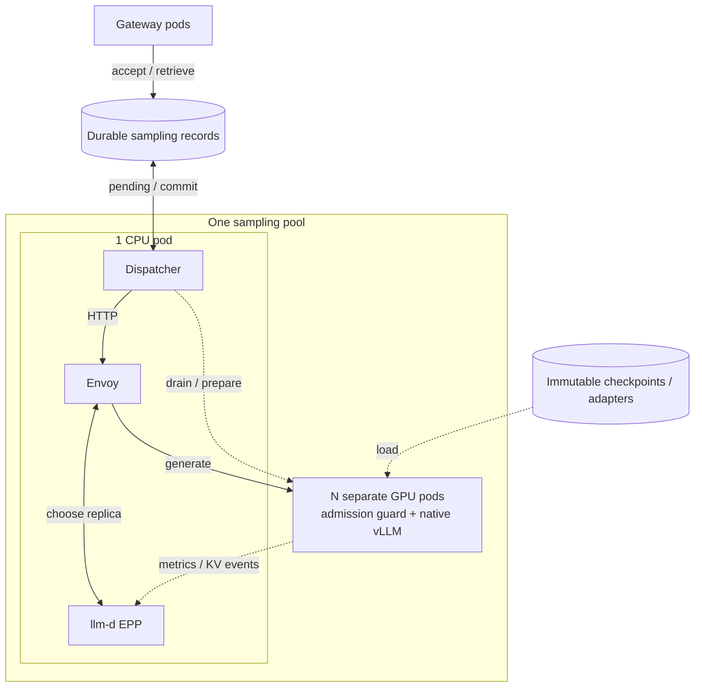

# Sampling pools for dedicated FFT and multi LoRA

**Status:** Proposed · **Date:** 2026-10-13

## Current sampling spans worker pull and HTTP push

At the original design baseline, commit `133e6ec`, the gateway pushes requests
into Redis lists. FFT and LoRA sampler workers
pull them with `BLPOP`/`LPOP`, call their embedded vLLM engine, and write results
back. Workers choose work by dequeueing; there is no inference HTTP hop where
llm-d could choose a replica. A worker crash after dequeue can lose a request.
Both [FFT](https://github.com/ShubyM/open-rl/blob/133e6ec75acc170d86820dcef3f2e61a5d7837e2/src/server/vllm_sampler.py) and
[LoRA](https://github.com/ShubyM/open-rl/blob/133e6ec75acc170d86820dcef3f2e61a5d7837e2/src/server/lora_sampler.py)
explicitly disable prefix caching at that baseline.

This draft branch already adds LoRA HTTP routing and enables its prefix cache.
Its [SamplerRouter](../../src/server/sampler_router.py) runs inside the API server
and retains expiring receipts without replay. Durable external dispatch and FFT
routing below remain proposed.

Move queue consumption into a small CPU dispatcher outside the gateway. It
reads durable pending work and **pushes HTTP requests through a configurable
inference URL**. GPU replicas become ordinary inference servers.

## HTTP routing and prefix cache reuse

The dispatcher decides **what may run**; llm-d decides **where it runs**.
A pool can use a direct endpoint or llm-d without changing request persistence
or weight management. With llm-d, Envoy forwards inference HTTP and the endpoint
picker (EPP) selects a backend.



Enable vLLM prefix caching and configure llm-d's **precise prefix-cache routing**,
balanced with queue depth and KV utilization. The cheaper approximate mode
remembers where prompts were sent; it can miss evictions. Precise mode consumes
vLLM KV events, including resets. Its index lives inside EPP; a separate cache
database or transfers between replicas are unnecessary.
[Routing modes](https://llm-d.ai/docs/0.9/architecture/advanced/kv-management/prefix-cache-aware-routing),
[KV indexer](https://llm-d.ai/docs/0.9/architecture/advanced/kv-management/kv-indexer).

Keep token IDs and logprobs through native `/inference/v1/generate`; llm-d
supports this path and can use the supplied tokens without another tokenizer.
[Token input support](https://github.com/llm-d/llm-d-router/blob/v0.9.0/pkg/epp/framework/plugins/requestcontrol/dataproducer/tokenizer/backend.go).

FFT cache reuse is **within one weight revision**. Each update invalidates old
KV. Use a trusted pool/revision `cache_salt` and unique immutable LoRA revision
names so engine and router identities agree. Add tenant scope when cache reuse
between tenants is prohibited.
[vLLM cache keys](https://github.com/vllm-project/vllm/blob/v0.25.1/vllm/v1/core/kv_cache_utils.py),
[llm-d identity handling](https://github.com/llm-d/llm-d-kv-cache/blob/v0.9.0/docs/architecture.md).

## Dispatcher durability and the FFT weight cycle

Keep three small implementation units: a concrete `SamplingStore`
(`accept/pending/complete/lookup`), `SamplingDispatcher.run()`, and a
`SamplerRuntime` admission/admin extension around native vLLM
(`generate/drain/prepare`). SamplingStore shares Redis infrastructure but does
not extend the existing general-purpose RequestStore abstraction.

Acceptance atomically records a request, immutable model reference, and client
idempotency key before acknowledgment. Reading pending work never removes it.
Completion atomically saves the first valid terminal result and removes pending.
Crashes and transient failures leave work retryable; lookup is nondestructive.
This gives at-least-once execution and one committed outcome, without durable
running states or request leases. Pending records must not expire; preserve
results for the retrieval contract and artifacts needed by pending work.

The [current Redis deployment](../../k8s/deploy/base/redis.yaml)
has neither a persistent volume nor AOF configuration. Surviving pod restarts
requires durable storage, acknowledgment after the chosen persistence boundary,
and no eviction of retained records. Disk-loss recovery requires additional
storage redundancy.

Each FFT pool belongs to one training lineage and serves one revision at a time:

1. The trainer publishes a complete, immutable revision R2. Pending requests
   naming R2 trigger a transition; publication alone does not interrupt R1.
2. The dispatcher stops new inference and calls `drain()` directly on every
   active replica. Each closes admission and finishes **all admitted requests**,
   including those waiting inside vLLM. An unreachable replica must be
   confirmed stopped before proceeding; a timeout is not a drain.
3. After that barrier, call `prepare(R2)` concurrently. Each replica loads the
   weights, invalidates KV, and reports ready only when every engine rank agrees.
   `AllBlocksCleared` events clear llm-d's old cache index asynchronously; the
   local admission/revision guard enforces correctness.
4. Resume R2 through the router once one replica is ready; slow replicas stay
   closed. Sampler GPUs remain resident and exclusive between batches.

Every attempt carries its expected pool and revision. The local guard atomically
checks identity and registers admission; mismatches are retryable. The dispatcher
validates executed identity before committing. Stale routing therefore cannot
produce a sample from the wrong weights. Old pending revisions get bounded,
fair turns using retained artifacts. Sparse deltas may remain inside `prepare`,
provided their exact parent is checked and cold replicas can reconstruct R2.

## Pods and isolation

Shared infrastructure is gateway pods, durable Redis, artifact storage, and
trainers on separate GPUs. Deploy each sampling pool independently:

| Pods | Responsibility |
| --- | --- |
| One CPU pod, three containers | Dispatcher, Envoy, EPP; bounded concurrency and one administrative owner |
| N GPU sampler pods | Native vLLM plus local guard; HTTP, metrics, KV events, authenticated administration |

Use a namespace, unique pool selector, and router endpoint per pool. An
`InferencePool` discovers only that pool's replicas. Enforced NetworkPolicies
allow sampler traffic only from its CPU pod; mount administrative credentials
only into the dispatcher. The three CPU containers share one network trust
boundary. Authenticate pool/model access locally and scope request/result keys
and artifact access to authorized tenants and jobs.

FFT pools have exclusive GPUs and no sampler time slicing. Set the scheduler's
existing [`spec.exclusive: true`](../../scheduler/docs/design.md) to prevent
later sharing before removing that integration. Expose each replica directly to EPP so it can distinguish their
independent KV caches.

Multi-LoRA pools share one exact compatible base revision. Use immutable adapter
names and native resolution/residency; reject missing adapters instead of
falling back to base weights. Adapter changes need no FFT barrier. This provides
model correctness while intentionally sharing capacity; tenants requiring
resource isolation get separate pools.

Scale GPU replicas first: new FFT replicas load the selected revision before
joining; scale-in closes admission and drains. Keep CPU readiness independent
of GPU availability. Replace the single dispatcher without overlap; after a
partition, fence or confirm termination of the old owner before takeover.
Pending work survives the pause.

## Static llm-d configuration

**Yes: llm-d v0.9 supports a file of literal vLLM IPv4 addresses and ports,
without Kubernetes discovery.** For example:

```yaml
endpoints:
  - name: sampler-0
    address: "10.0.0.10"
    port: "8000"
  - name: sampler-1
    address: "10.0.0.11"
    port: "8000"
```

Use `file-discovery` with `watchFile: true` in the
[release-matched EPP configuration](https://github.com/llm-d/llm-d/blob/v0.9.0/guides/no-kubernetes-deployment/router/epp/config.yaml).
Envoy plus EPP handle forwarding and selection; metrics and KV-event
connectivity enable cache-aware decisions. The file supplies HTTP membership;
precise routing also needs configured KV-event subscriptions. Our deployment
machinery still updates membership when endpoints change, and the dispatcher owns FFT cycles.
For Kubernetes scaling, prefer automatic `InferencePool` discovery.
[Static deployment guide](https://github.com/llm-d/llm-d/blob/v0.9.0/guides/no-kubernetes-deployment/README.md).

Before rollout, test the selected llm-d release with pinned vLLM 0.30.0 for
token/logprob fidelity, FFT cache resets, mixed adapters, and crash replay.
The original baseline's two sampler loops totaled 646 lines; this draft already
unifies them. Net savings depend on the replacement, and weight-transfer code remains.
